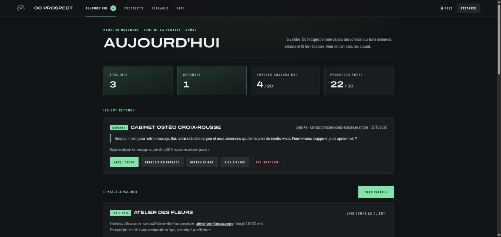
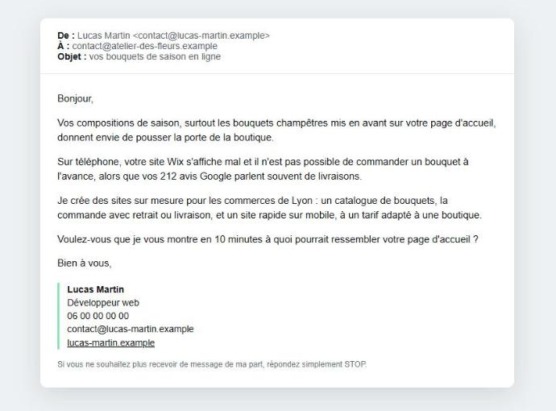
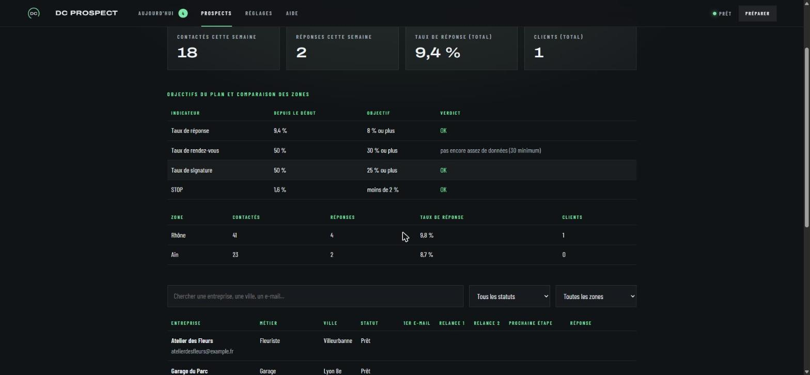

<p align="center">
  
</p>

<p align="center">
  
  
  
  
</p>

<p align="center">
  <a href="https://github.com/Djason16/dc-prospect/releases/latest"><b>TÉLÉCHARGER</b></a> &nbsp;&nbsp;·&nbsp;&nbsp; <a href="docs/01-installation.md"><b>INSTALLER</b></a> &nbsp;&nbsp;·&nbsp;&nbsp; <a href="#documentation"><b>DOCUMENTATION</b></a>
</p>


Application Windows qui fait la prospection par e-mail à ta place, pour n'importe quel indépendant ou petite entreprise.

Les jours de recherche que tu choisis, DC Prospect cherche sur le web de petites entreprises de tes métiers cibles dans ta zone, garde celles qui publient un e-mail professionnel sur leur propre site et qui montrent un besoin, vérifie l'e-mail et l'entreprise (registre officiel), puis Claude rédige le premier e-mail en ton nom. **Tu valides.** DC Prospect envoie depuis ton adresse pro aux bons moments, relance (J+4 et J+11 par défaut), lit les réponses, retire les STOP et tient le tableau de suivi et les rapports.

> **Rien ne part sans ta validation.** Chaque e-mail (premier envoi et relances) passe par l'écran « Aujourd'hui ».

<table>
  <tr>
    <td width="50%"></td>
    <td width="50%"></td>
  </tr>
  <tr>
    <td width="50%"></td>
    <td width="50%"></td>
  </tr>
</table>

<sub>L'accueil du jour, un e-mail à valider, l'e-mail tel que le prospect le reçoit, puis les chiffres et les zones. Données de démonstration (entreprises inventées).</sub>


## En 30 secondes
1. Installe DC Prospect : télécharge `DC-Prospect-Setup-<version>.exe` dans les [releases](https://github.com/Djason16/dc-prospect/releases), puis installe Claude Code (l'application te le propose).
2. Au premier lancement, la mise en route te guide : **ton profil**, **ta zone**, **tes comptes** (Claude et ton Gmail, ou ta boîte pro).
3. Ensuite, chaque jour d'envoi (mardi, mercredi et jeudi par défaut, tout se règle dans Réglages, Avancé, Calendrier), DC Prospect s'ouvre avec les e-mails du jour : relis, clique sur **Tout valider**, c'est fini.

## Documentation
| Chapitre | Contenu |
|---|---|
| [1. Installation](docs/01-installation.md) | Ce qu'il faut, installer, mettre à jour, utiliser Google Drive, plusieurs PC, désinstaller |
| [2. Premier lancement](docs/02-premier-lancement.md) | La mise en route : profil, zone, Claude, Gmail ou boîte pro, e-mail de test |
| [3. Utilisation au quotidien](docs/03-utilisation.md) | La routine de 10 minutes, les écrans, valider, répondre, suivre les chiffres |
| [4. Réglages](docs/04-reglages.md) | Profil, signatures, comptes, zones, métiers, volumes, serveur mail, Google, fichiers |
| [5. Comment ça marche](docs/05-fonctionnement.md) | La recherche, la séquence, le calendrier (jours, créneaux, relances), les réponses, les rapports |
| [6. Règles, données et sécurité](docs/06-donnees-et-securite.md) | RGPD et délivrabilité, où sont les fichiers, secrets, verrou entre PC, MCP |
| [7. Dépannage](docs/07-depannage.md) | Les messages d'erreur et quoi faire |
| [8. Développement](docs/08-developpement.md) | Architecture, API, lancer en développement, fabriquer et publier l'installateur |

<p align="center"></p>

## Ce qu'il faut
- Windows 10 ou 11.
- Un abonnement Claude (Pro ou Max) et **Claude Code** sur le PC : c'est lui qui cherche et qui rédige.
- Une adresse e-mail professionnelle (ton domaine), envoyée par ton Gmail (« Envoyer en tant que ») ou directement par ta boîte (n'importe quel hébergeur).
- Idéalement Google Drive pour ordinateur, pour retrouver tes données sur tous tes PC.

## Le projet
Application privée, rangée selon l'architecture de DC Scaffold (indépendante de DC Scaffold). Electron + Node.js, sans framework côté interface (HTML, CSS, modules JavaScript). Voir [8. Développement](docs/08-developpement.md).

```
dc-prospect/
├── backend/            le moteur et l'API locale (http://localhost:4747/api)
├── frontend/           l'interface (pages, assets/css, js)
├── electron/main.mjs   l'application Windows
├── ressources/prompts/ prompts neutres livrés avec l'application
├── build/icon.png      icône
├── assets/readme/      images du README
├── docs/               cette documentation
├── scripts/            publier.ps1
├── start.bat, start.ps1  le menu du projet
├── config.json         réglages par défaut (rien de personnel)
└── package.json
```

## Version
1.1.0 : voir [CHANGELOG.md](CHANGELOG.md).
