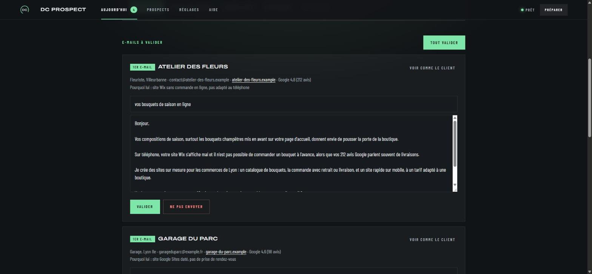
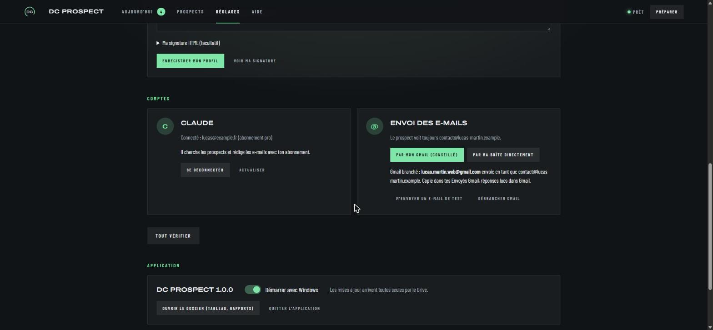

<p align="center">
  
</p>

<p align="center">
  
  
  
  
</p>

<p align="center">
  <a href="https://github.com/Djason16/dc-prospect/releases/latest"><b>TÉLÉCHARGER</b></a> &nbsp;&nbsp;·&nbsp;&nbsp; <a href="docs/01-installation.md"><b>INSTALLER</b></a> &nbsp;&nbsp;·&nbsp;&nbsp; <a href="#documentation"><b>DOCUMENTATION</b></a>
</p>


Application Windows qui fait la prospection par e-mail à ta place, pour n'importe quel indépendant ou petite entreprise.

Les jours de recherche que tu choisis, DC Prospect prend dans le registre officiel les petites entreprises de tes métiers qui acceptent la prospection, dans ta zone (une ville et un rayon suffisent). Il retrouve et lit leur site, garde celles qui publient un e-mail professionnel et montrent un besoin, puis rédige le premier e-mail en ton nom avec les constats vérifiés sur leur site. **Tu valides.** DC Prospect envoie depuis ton adresse aux bons moments, relance (J+4 et J+11 par défaut), lit et classe les réponses, prépare tes réponses, retire les STOP et tient le tableau de suivi et les rapports.

**Avec ou sans IA, gratuit ou non, au choix :**
- **Gratuit, sur ce PC** : une IA intégrée (Qwen3 4B ou Ministral 3 8B de Mistral, licence Apache 2.0) téléchargée une fois, sans compte ni abonnement, qui fonctionne même hors ligne ;
- **Gratuit, en ligne** : Google Gemini avec une clé gratuite, qui cherche aussi les prospects sur Google ;
- **Ton abonnement Claude** (Claude Code), ou **une clé API** (Anthropic, OpenAI, Mistral, Groq, OpenRouter, Ollama).

Une **IA interne** apprend de tes propres résultats : elle met en tête les prospects qui ont le plus de chances de répondre, garde les objets et les longueurs d'e-mail qui marchent, reconnaît le type des réponses et ralentit l'envoi toute seule si trop d'e-mails reviennent.

> **Rien ne part sans ta validation.** Chaque e-mail (premier envoi et relances) passe par l'écran « Aujourd'hui ».

<table>
  <tr>
    <td width="50%"></td>
    <td width="50%"></td>
  </tr>
  <tr>
    <td width="50%"></td>
    <td width="50%"></td>
  </tr>
</table>

<sub>L'accueil du jour, un e-mail à valider, l'e-mail tel que le prospect le reçoit, puis les chiffres et les zones. Données de démonstration (entreprises inventées). Captures de la version 1.2.0.</sub>


## En 30 secondes
1. Installe DC Prospect : télécharge `DC-Prospect-Setup-<version>.exe` dans les [releases](https://github.com/Djason16/dc-prospect/releases) et lance-le.
2. Au premier lancement, la mise en route te guide en 4 étapes : **ton profil** (avec un exemple pour ton activité), **ta zone** (ta ville et un rayon), **ta formule** (l'IA gratuite se télécharge en un clic), **ton adresse d'envoi** (serveur trouvé tout seul à partir de ton adresse). La première recherche démarre aussitôt.
3. Ensuite, chaque jour d'envoi (mardi, mercredi et jeudi par défaut, tout se règle dans Réglages, Avancé, Calendrier), DC Prospect s'ouvre avec les e-mails du jour : relis, clique sur **Tout valider**, c'est fini.

## Documentation
| Chapitre | Contenu |
|---|---|
| [1. Installation](docs/01-installation.md) | Ce qu'il faut, installer, mettre à jour, utiliser Google Drive, plusieurs PC, désinstaller |
| [2. Premier lancement](docs/02-premier-lancement.md) | La mise en route en 4 étapes : profil, zone (ville et rayon), formule (IA gratuite, Gemini, Claude ou clé API), adresse d'envoi, e-mail de test |
| [3. Utilisation au quotidien](docs/03-utilisation.md) | La routine de 10 minutes, les écrans, valider, répondre, suivre les chiffres |
| [4. Réglages](docs/04-reglages.md) | Profil, signatures, formule (IA ou sans IA), envoi, délivrabilité, zones, métiers, volumes, calendrier, modèles d'e-mails, serveur mail, Google, fichiers |
| [5. Comment ça marche](docs/05-fonctionnement.md) | La recherche, l'IA intégrée, l'IA interne, la séquence, le calendrier, les réponses, les rapports |
| [6. Règles, données et sécurité](docs/06-donnees-et-securite.md) | RGPD et délivrabilité, où sont les fichiers, secrets, verrou entre PC, MCP |
| [7. Dépannage](docs/07-depannage.md) | Les messages d'erreur et quoi faire |
| [8. Développement](docs/08-developpement.md) | Architecture, API, lancer en développement, fabriquer et publier l'installateur |
| [9. Vendre DC Prospect](docs/09-vendre.md) | Ce qu'il reste à faire pour en faire un produit : licence, paiement, CGV, RGPD, signature, support |

<p align="center"></p>

## Ce qu'il faut
- Windows 10 ou 11.
- Rien d'autre pour la formule gratuite : environ 3 Go d'espace disque pour l'IA intégrée (une carte graphique la rend plus rapide, mais n'est pas nécessaire). Sinon une clé Google Gemini gratuite, un abonnement Claude (Pro ou Max) ou une clé API.
- Une adresse e-mail (de préférence à ton domaine), envoyée par ton Gmail ou directement par ta boîte (n'importe quel hébergeur ; le serveur est trouvé tout seul).
- Facultatif : une clé Brave (crédit gratuit de 5 $ par mois) pour retrouver plus de sites, une clé Google PageSpeed (gratuite) pour mesurer leur vitesse.
- Idéalement Google Drive pour ordinateur, pour retrouver tes données sur tous tes PC.

## Le projet
Application privée, rangée selon l'architecture de DC Scaffold (indépendante de DC Scaffold). Electron + Node.js, tout en TypeScript strict compilé par `tsc` dans `out/` (`npm run build:ts`, vérification : `npm run typecheck`), sans framework ni bundler côté interface (HTML, CSS, modules ES). Voir [8. Développement](docs/08-developpement.md).

```
dc-prospect/
├── backend/            le moteur et l'API locale (http://localhost:4747/api)
├── frontend/           l'interface (pages, assets/css, js en TypeScript)
├── electron/main.ts    l'application Windows
├── out/                le JavaScript compilé (npm run build:ts), pas dans Git
├── resources/prompts/ prompts neutres livrés avec l'application
├── resources/templates/ modèles d'e-mails de la rédaction sans IA (modifiables dans l'appli)
├── build/icon.png      icône
├── assets/readme/      images du README
├── docs/               cette documentation
├── scripts/            publish.ps1
├── start.bat, start.ps1  le menu du projet
├── config.json         réglages par défaut (rien de personnel)
├── tsconfig*.json      réglages de TypeScript (et frontend/js/tsconfig.json)
└── package.json
```

## Licence
Tous droits réservés © 2026 Djason CHERY : voir [`LICENSE`](LICENSE). Les données créées avec DC Prospect appartiennent
à la personne qui l'utilise ; les modèles d'IA intégrés gardent leur propre licence (Apache 2.0).

## Version
1.3.1 : voir [CHANGELOG.md](CHANGELOG.md).
